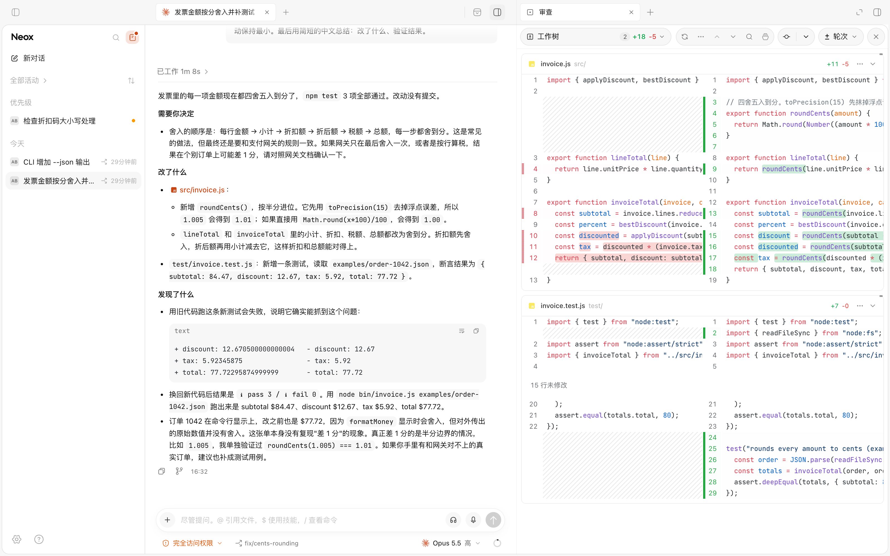
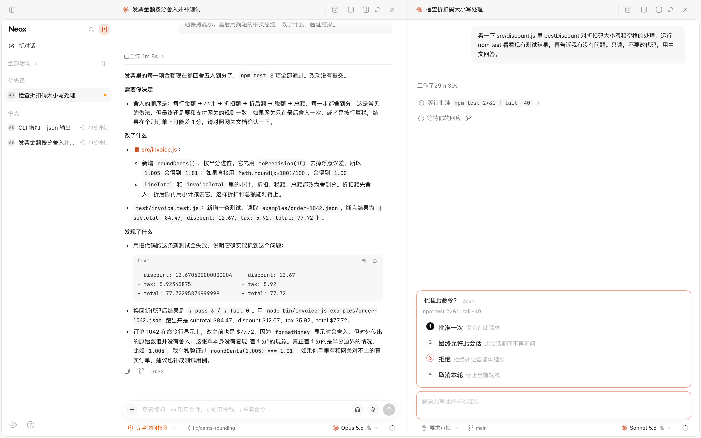
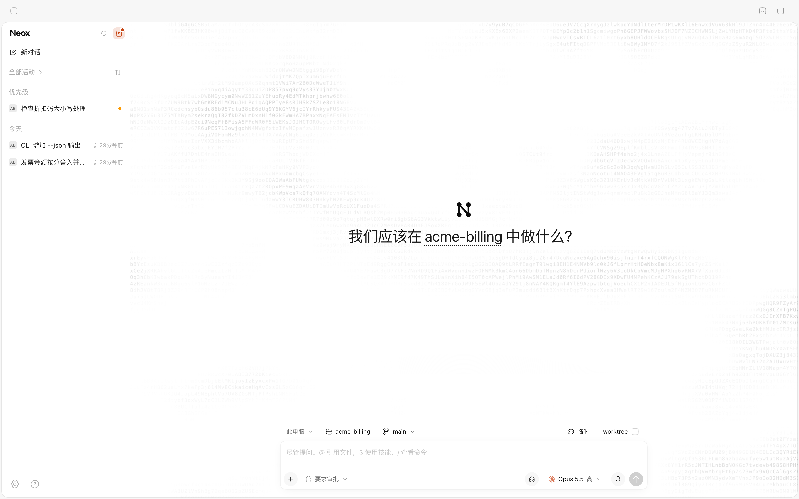

<div align="center">



# Neox

**One window for all your AI coding agents.**

Run them in parallel, approve each step, review the diff before you merge.

[](https://github.com/istoo/neox/releases/latest)
[](#install)
[](LICENSE)

[Download](#install) · [Features](#features) · [Get started](#get-started) · [Build from source](#build-from-source) · [简体中文](README.md)

<br>

<picture>
  <source media="(prefers-color-scheme: dark)" srcset="docs/images/review-dark.png">
  
</picture>

</div>

<br>

Neox is a desktop AI coding tool and agent orchestrator. Claude Code, Codex, GitHub Copilot, OpenCode and other agents work in one interface: one thread per task, as many as you want at once, each in its own git worktree if you like. Agents ask before they run a command or edit a file. When they finish, the diff, terminal, browser and Git actions sit next to the thread.

Your code and your agents run on your own computer.

## Features

<table>
  <tr>
    <td width="50%" valign="top">
      <h3>Agents in parallel</h3>
      Run any number of threads at once and view them side by side. Each thread can work in its own worktree and branch, so changes never overwrite each other.
    </td>
    <td width="50%" valign="top">
      <h3>One interface, many agents</h3>
      Claude Code, Codex, GitHub Copilot, OpenCode, Pi, Antigravity and Muse Code. Pick the agent, model and reasoning effort per task.
    </td>
  </tr>
  <tr>
    <td valign="top">
      <h3>Approve each step</h3>
      Commands and edits wait for you: approve once, allow for the thread, or decline. Or give a single thread full access.
    </td>
    <td valign="top">
      <h3>Review, then merge</h3>
      Read the diff file by file, then commit, push and open a pull request. Terminal, built-in browser and file browser live in the side panel.
    </td>
  </tr>
  <tr>
    <td valign="top">
      <h3>Local model gateway</h3>
      Serves your model sources behind OpenAI, Anthropic and Gemini compatible endpoints, with routing, failover, keys, quotas and sensitive-data masking. Other tools can use it too.
    </td>
    <td valign="top">
      <h3>Extensible</h3>
      MCP servers, skills, plugins and scheduled automations. The <code>neox</code> CLI creates and manages agents from scripts.
    </td>
  </tr>
</table>

<picture>
  <source media="(prefers-color-scheme: dark)" srcset="docs/images/parallel-dark.png">
  
</picture>

<p align="center"><sub>Two threads side by side: the left agent fixed a bug in the <code>fix/cents-rounding</code> worktree, the right one is waiting for you to approve <code>npm test</code>.</sub></p>

## Install

Download the package for your platform from [Releases](https://github.com/istoo/neox/releases/latest):

| Platform              | Package                                                 | Requires            |
| :-------------------- | :------------------------------------------------------ | :------------------ |
| macOS (Apple silicon) | `Neox-<version>-arm64.dmg`                              | macOS 13 or later   |
| macOS (Intel)         | `Neox-<version>-x64.dmg`                                | macOS 13 or later   |
| Windows               | `Neox-Setup-<version>-x64.exe`, `arm64` for ARM devices | Windows 10 or later |
| Linux                 | `.AppImage`, `.deb`, `.rpm`, `.tar.gz`                  | x64                 |

> [!NOTE]
> The macOS app is not signed with an Apple Developer ID yet. If macOS blocks it the first time, open System Settings › Privacy & Security and choose Open Anyway, or run:
>
> ```sh
> xattr -dr com.apple.quarantine /Applications/Neox.app
> ```

### Install on macOS from the command line

On macOS (Apple silicon or Intel), you can skip the DMG and run the installer script instead:

```sh
curl -fsSL https://github.com/istoo/neox/releases/latest/download/install.sh | sh
```

For a prerelease, put its tag in the path:

```sh
curl -fsSL https://github.com/istoo/neox/releases/download/v0.17.0-beta.1/install.sh | sh
```

`latest` follows stable releases only and never selects a prerelease. The script downloads the ZIP for your CPU architecture from the same release, verifies its SHA-512, and unpacks it into `~/Applications`: stable installs as `Neox.app`, beta as `Neox Beta.app`. It never overwrites an existing app at that path (symlinks included), does not use `sudo`, does not launch the app, and does not stop or modify a running older version. Both installs share the existing application data. The macOS app is not signed yet; if macOS blocks the first launch, follow the note above.

### Updates

| Installed from               | How it updates                                             |
| :--------------------------- | :--------------------------------------------------------- |
| Windows, Linux AppImage      | Downloads in the background and finishes on restart        |
| macOS, Linux `.deb` / `.rpm` | Tells you a new version is out and opens its download page |
| Linux `.tar.gz`              | Download the new version from Releases                     |

## Get started

1. **Install an agent's CLI** and sign in, for example `claude` from [Claude Code](https://docs.anthropic.com/en/docs/claude-code) or `codex` from [Codex](https://github.com/openai/codex). Neox finds it; Settings › Agents shows its status.
2. **Open a project**: pick a folder on the home screen, and tick worktree to give the thread its own branch.
3. **Describe the task**, choose the agent and model, and send. Approve or decline commands in the thread; when it is done, open Review in the side panel to read the diff and commit.

<picture>
  <source media="(prefers-color-scheme: dark)" srcset="docs/images/home-dark.png">
  
</picture>

## Build from source

You need Node.js 22 and [Bun](https://bun.sh) 1.4.

```sh
git clone https://github.com/istoo/neox.git && cd neox
npm install
(cd packages/desktop-web && bun install)

npm run dev            # development daemon on 127.0.0.1:6768
npm run dev:desktop    # desktop app
```

Development data lives in `.dev/` inside the checkout and never touches an installed Neox. See [docs/development.md](docs/development.md) for more.

<details>
<summary><b>Repository layout</b></summary>

<br>

| Path                                   | Contents                                                   |
| :------------------------------------- | :--------------------------------------------------------- |
| `packages/desktop`                     | Electron shell: windows, daemon management, auto-update    |
| `packages/desktop-web`                 | Desktop interface (React) and its bridge to the daemon     |
| `packages/server`                      | Daemon: agent lifecycle, WebSocket API, model gateway, MCP |
| `packages/cli`                         | The `neox` command-line tool                               |
| `packages/protocol`, `packages/client` | Wire protocol and client SDK                               |
| `docs/`                                | Architecture, data model, testing and release docs         |

</details>

## Feedback

- Found a bug: [open an issue](https://github.com/istoo/neox/issues/new/choose)
- Ideas and questions: [Discussions](https://github.com/istoo/neox/discussions)
- Security issues: report them through [private vulnerability reporting](https://github.com/istoo/neox/security/advisories/new), not as a public issue

Read [CONTRIBUTING.md](CONTRIBUTING.md) before you send a change.
