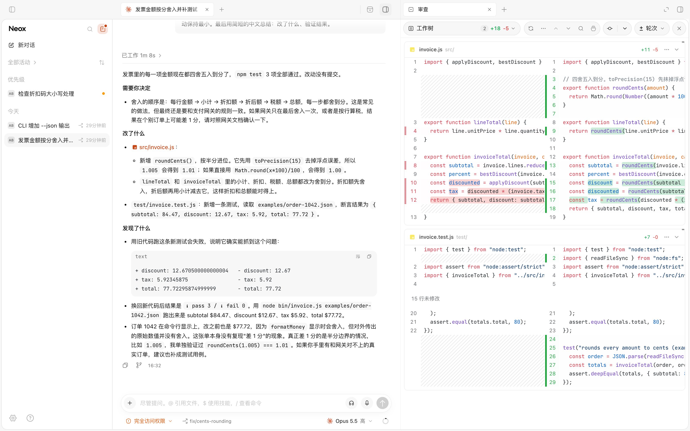
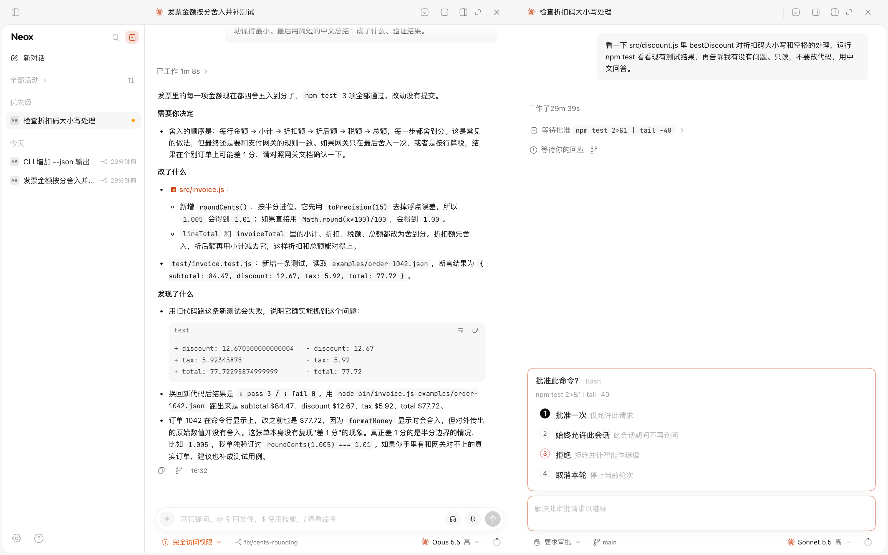
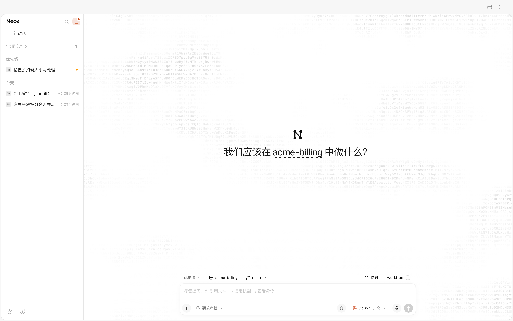

<div align="center">



# Neox

**一个窗口，指挥你所有的 AI 编程智能体。**

并行开工，每一步先问你，看完差异再合并。

[](https://github.com/istoo/neox/releases/latest)
[](#安装)
[](LICENSE)

[下载](#安装) · [功能](#功能) · [快速上手](#快速上手) · [从源码构建](#从源码构建) · [English](README.en.md)

<br>

<picture>
  <source media="(prefers-color-scheme: dark)" srcset="docs/images/review-dark.png">
  
</picture>

</div>

<br>

Neox 是一个桌面端的 AI 编程工具和智能体编排器。Claude Code、Codex、GitHub Copilot、OpenCode 等智能体在同一个界面里工作：一个任务一个对话，可以同时开很多个，每个都能放进自己的 git worktree 里互不干扰。智能体要跑命令、改文件时先征得你同意；做完之后，差异、终端、浏览器和 Git 操作就在对话旁边。

所有代码和智能体都运行在你自己的电脑上。

## 功能

<table>
  <tr>
    <td width="50%" valign="top">
      <h3>多个智能体并行</h3>
      同时运行任意多个对话，分屏并排查看。每个对话可以在独立的 worktree 和分支上工作，改动互不覆盖。
    </td>
    <td width="50%" valign="top">
      <h3>一套界面，多种智能体</h3>
      Claude Code、Codex、GitHub Copilot、OpenCode、Pi、Antigravity、Muse Code。按任务挑选智能体、模型和推理强度。
    </td>
  </tr>
  <tr>
    <td valign="top">
      <h3>逐条审批</h3>
      命令和文件改动先问你，可以批准一次、对当前对话放行，或者拒绝。也可以给单个对话开放完全访问。
    </td>
    <td valign="top">
      <h3>审查后再合并</h3>
      逐文件查看差异，直接提交、推送、开拉取请求。终端、内置浏览器和文件浏览都在右侧面板里。
    </td>
  </tr>
  <tr>
    <td valign="top">
      <h3>本机模型网关</h3>
      把多个模型来源统一成 OpenAI、Anthropic、Gemini 兼容接口，支持路由、故障切换、密钥、用量配额和敏感信息脱敏。其他工具也能接进来用。
    </td>
    <td valign="top">
      <h3>可扩展</h3>
      MCP 服务器、技能、插件和定时自动化。命令行工具 <code>neox</code> 可以在脚本里创建和管理智能体。
    </td>
  </tr>
</table>

<picture>
  <source media="(prefers-color-scheme: dark)" srcset="docs/images/parallel-dark.png">
  
</picture>

<p align="center"><sub>分屏并排两个对话：左边的智能体在 <code>fix/cents-rounding</code> worktree 里修完了 bug，右边的正在等你批准 <code>npm test</code>。</sub></p>

## 安装

从 [Releases](https://github.com/istoo/neox/releases/latest) 下载对应平台的安装包：

| 平台                | 安装包                                          | 系统要求          |
| :------------------ | :---------------------------------------------- | :---------------- |
| macOS（Apple 芯片） | `Neox-<版本>-arm64.dmg`                         | macOS 13 或更高   |
| macOS（Intel）      | `Neox-<版本>-x64.dmg`                           | macOS 13 或更高   |
| Windows             | `Neox-Setup-<版本>-x64.exe`，ARM 设备用 `arm64` | Windows 10 或更高 |
| Linux               | `.AppImage`、`.deb`、`.rpm`、`.tar.gz`          | x64               |

> [!NOTE]
> macOS 版暂未使用 Apple 开发者证书签名。第一次打开如果被系统拦下，到「系统设置 › 隐私与安全性」点「仍要打开」，或者在终端运行：
>
> ```sh
> xattr -dr com.apple.quarantine /Applications/Neox.app
> ```

### 更新

| 安装方式                     | 更新方式                             |
| :--------------------------- | :----------------------------------- |
| Windows、Linux AppImage      | 后台自动下载，重启后完成更新         |
| macOS、Linux `.deb` / `.rpm` | 有新版本时提示你，点一下打开下载页面 |
| Linux `.tar.gz`              | 到 Releases 手动下载                 |

## 快速上手

1. **安装智能体的命令行工具**，并完成登录，例如 [Claude Code](https://docs.anthropic.com/en/docs/claude-code) 的 `claude`、[Codex](https://github.com/openai/codex) 的 `codex`。Neox 会自动检测，在「设置 › 智能体」里可以看到状态。
2. **打开项目**：在首页选择一个文件夹，或者勾选 worktree，让这个对话在单独的分支上工作。
3. **描述任务**，选好智能体和模型后发送。智能体要执行命令时，在对话里批准或拒绝；完成后打开右侧的「审查」看差异，满意就提交。

<picture>
  <source media="(prefers-color-scheme: dark)" srcset="docs/images/home-dark.png">
  
</picture>

## 从源码构建

需要 Node.js 22 和 [Bun](https://bun.sh) 1.4。

```sh
git clone https://github.com/istoo/neox.git && cd neox
npm install
(cd packages/desktop-web && bun install)

npm run dev            # 开发用守护进程，监听 127.0.0.1:6768
npm run dev:desktop    # 桌面端
```

开发环境的数据保存在仓库内的 `.dev/`，不会影响已安装的 Neox。更多说明见 [docs/development.md](docs/development.md)。

<details>
<summary><b>目录结构</b></summary>

<br>

| 路径                                   | 内容                                                   |
| :------------------------------------- | :----------------------------------------------------- |
| `packages/desktop`                     | Electron 桌面外壳：窗口、守护进程管理、自动更新        |
| `packages/desktop-web`                 | 桌面端界面（React）和连接守护进程的桥接服务            |
| `packages/server`                      | 守护进程：智能体生命周期、WebSocket API、模型网关、MCP |
| `packages/cli`                         | 命令行工具 `neox`                                      |
| `packages/protocol`、`packages/client` | 通信协议与客户端 SDK                                   |
| `docs/`                                | 架构、数据模型、测试与发布文档                         |

</details>

## 反馈

- 发现 bug：[提交 Issue](https://github.com/istoo/neox/issues/new/choose)
- 想法和建议：[Discussions](https://github.com/istoo/neox/discussions)
- 安全问题：请通过 [私密漏洞报告](https://github.com/istoo/neox/security/advisories/new) 提交，不要公开发 Issue

参与开发前请先阅读 [CONTRIBUTING.md](CONTRIBUTING.md)。
